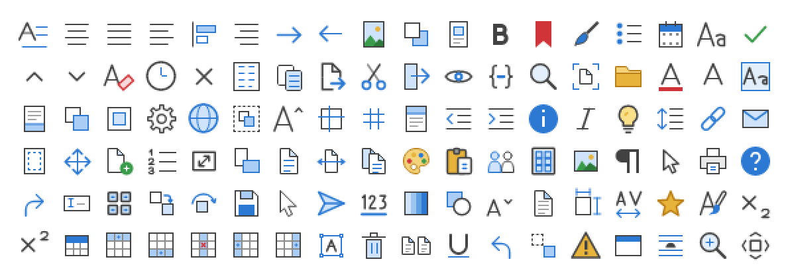

# Kernicons — icons from KernPage

**A crisp, themeable SVG icon set for desktop apps, drawn by hand on a 16 px grid.**

Kernicons is the icon set of [KernPage](https://github.com/jmitchell238/kernpage), published on its own so it can be versioned separately and used anywhere.

## Why "Kernicons"?

Kernicons is the icon set of KernPage. *Kern* is the typesetter's term for adjusting the space between letters so a line of type looks right. The name says what these are: icons drawn with a typesetter's care, for a page-layout app. Kern + icons.

<picture>
  <source media="(prefers-color-scheme: dark)" srcset="docs/images/overview-dark.png">
  
</picture>

*Every icon at 24 px, magnified 2x so you can see the real pixels. See the [gallery](docs/GALLERY.md) for names and 16 / 20 / 24 px sheets.*

## What makes the set

- **Our own drawings.** All 108 icons were drawn for KernPage; no third-party artwork.
- **A 16 px grid.** Every icon has a 16 x 16 base design, laid out on a 0.25 grid so it stays sharp at 16, 32 and 48 px.
- **`currentColor` ink.** Outlines use `currentColor`, so an icon takes any theme colour (light on dark, one flat tint, or a disabled grey) with no extra files.
- **Hand-tuned size variants.** Nearly every icon (100 of 108) also has `@20` and `@24` drawings, and 56 have `@28`, `@35` and `@42`. These are redrawn, not just scaled, so strokes land on whole pixels at higher DPI.
- **Exact device-pixel rendering.** Icons are rasterised with [resvg](https://github.com/linebender/resvg) at precisely the pixel size you ask for, then painted on whole pixels.

## Quick start

### egui (default `egui` feature)

```toml
[dependencies]
kernicons = "0.1"
```

```rust
use kernicons::{paint, Mode};

// `rect` is any egui Rect; the icon fills its largest centred square.
paint(ui.painter(), rect, "bold", Mode::Colour);
paint(ui.painter(), rect, "bold", Mode::Disabled);                          // flat grey
paint(ui.painter(), rect, "bold", Mode::ColourInk(egui::Color32::WHITE));   // light ink for dark themes
paint(ui.painter(), rect, "bold", Mode::Mono(egui::Color32::RED));          // one colour
```

Textures are created at `round(side * pixels_per_point)` pixels and cached per egui context.

### Plain Rust (no egui)

```toml
[dependencies]
kernicons = { version = "0.1", default-features = false }
```

```rust
use kernicons::{names, render_rgba, svg, Color, Mode};

for name in names() { /* "abc", "align-center", ... sorted */ }

let source: &str = svg("bold").unwrap();                    // the 16 px SVG text
let img = render_rgba("bold", 24, Mode::Colour).unwrap();   // 24 x 24 straight-alpha RGBA8
let white = render_rgba("bold", 32, Mode::Mono(Color::WHITE)).unwrap();
assert_eq!(img.rgba.len(), (img.width * img.height * 4) as usize);
```

Without the `egui` feature, `Color` is a small stand-in with the same constructors as `egui::Color32`.

### Colour modes

| Mode | Result |
| --- | --- |
| `Colour` | Palette as drawn; `currentColor` is `#424242` |
| `ColourInk(c)` | As drawn, but the outline ink is `c` (light icons on dark backgrounds) |
| `Disabled` | Every colour mapped to a flat grey; light fills stay light |
| `Mono(c)` | One colour: dark and mid colours become `c`, light fills become transparent |

## How size variants are chosen

For a request of `px` device pixels:

1. If `px` is an exact multiple of one or more design sizes (16 counts), use the largest such design. So 24 and 48 use `@24`, 20 and 40 use `@20`, 16 and 32 use the 16 design.
2. Otherwise use the largest design not bigger than `px` (22 uses `@20`).
3. Otherwise (below 16) use the 16 design.

`kernicons::design_size(name, px)` tells you which one is picked.

## Adding or editing an icon

Short version (full rules in [CONTRIBUTING.md](CONTRIBUTING.md)):

1. Draw `icons/<name>.svg` with `viewBox="0 0 16 16"`, on the 0.25 grid, ink as `currentColor`.
2. Optionally add `icons/<name>@20.svg` and `@24.svg` (`viewBox` 20 and 24) drawn for those sizes.
3. Register the files in `src/table.rs` (sorted by name) and add the icon to a category in `examples/make_gallery.rs`.
4. `cargo test`, then `cargo run --example make_gallery` to refresh the images.

## Versioning

Semantic versioning. Adding icons or size variants is a **minor** release; changing the API, or removing or renaming an icon, is a **major** release. Redrawing an existing icon is a patch or minor release. See [CHANGELOG.md](CHANGELOG.md).

## Licence

Licensed under either of [Apache License 2.0](LICENSE-APACHE) or [MIT](LICENSE-MIT), at your option. Unless you state otherwise, any contribution you submit is dual licensed as above, with no additional terms.

Kernicons is the icon set from [KernPage](https://github.com/jmitchell238/kernpage).
