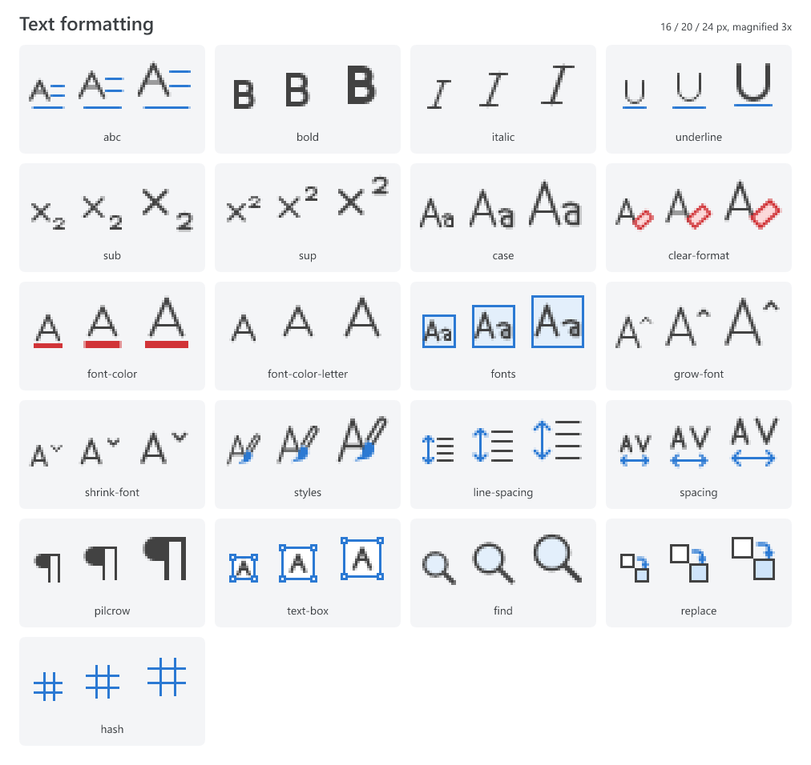
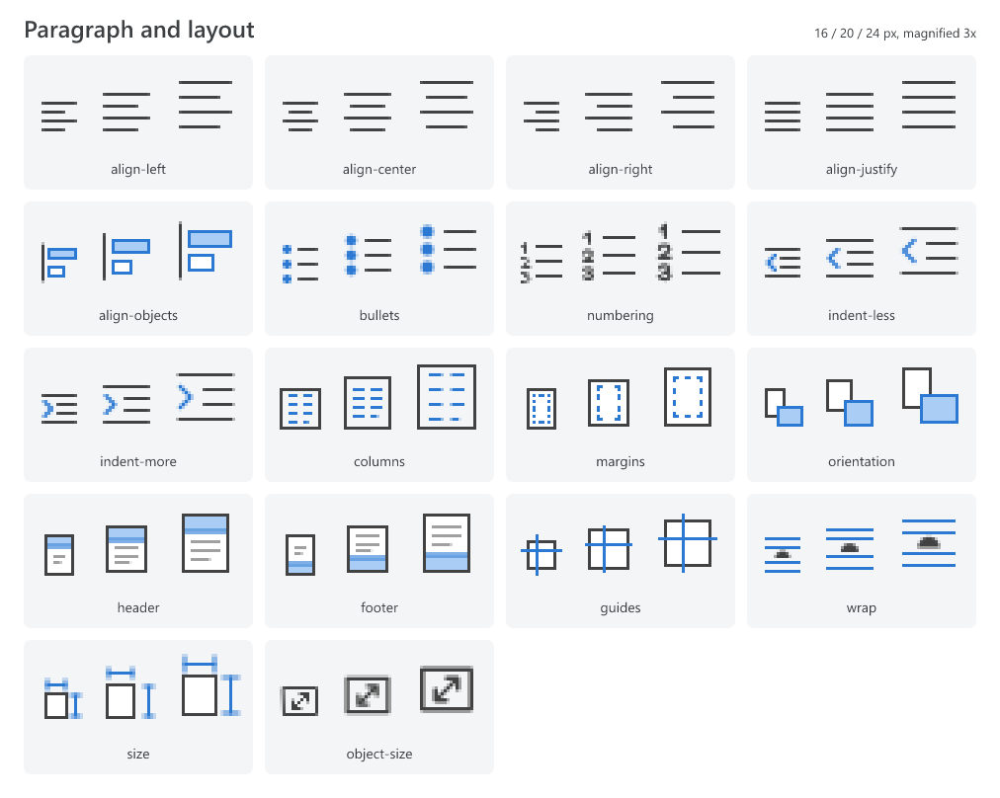
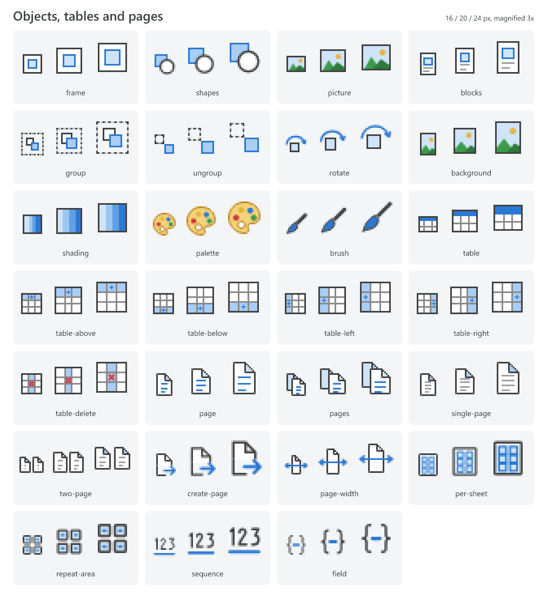
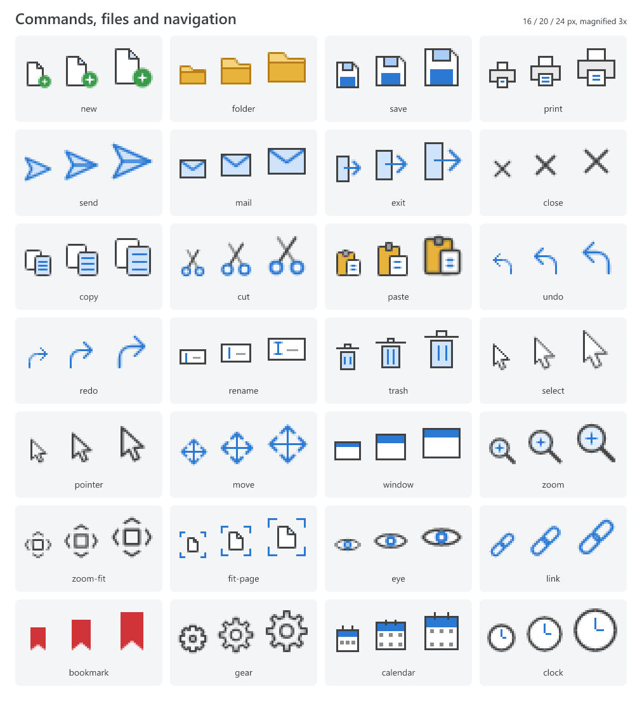
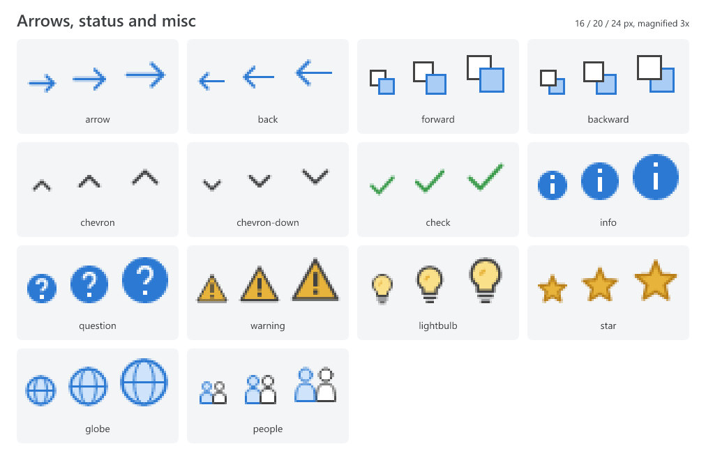

# Gallery

Every icon, by category. Each sheet shows the icon at 16, 20 and 24 px, magnified 3x with nearest-neighbour so you see the real pixels. Regenerate with `cargo run --example make_gallery`.

## Text formatting

<picture>
  <source media="(prefers-color-scheme: dark)" srcset="images/sheet-text-dark.png">
  
</picture>

`abc`, `bold`, `italic`, `underline`, `sub`, `sup`, `case`, `clear-format`, `font-color`, `font-color-letter`, `fonts`, `grow-font`, `shrink-font`, `styles`, `line-spacing`, `spacing`, `pilcrow`, `text-box`, `find`, `replace`, `hash`

## Paragraph and layout

<picture>
  <source media="(prefers-color-scheme: dark)" srcset="images/sheet-paragraph-dark.png">
  
</picture>

`align-left`, `align-center`, `align-right`, `align-justify`, `align-objects`, `bullets`, `numbering`, `indent-less`, `indent-more`, `columns`, `margins`, `orientation`, `header`, `footer`, `guides`, `wrap`, `size`, `object-size`

## Objects, tables and pages

<picture>
  <source media="(prefers-color-scheme: dark)" srcset="images/sheet-objects-dark.png">
  
</picture>

`frame`, `shapes`, `picture`, `blocks`, `group`, `ungroup`, `rotate`, `background`, `shading`, `palette`, `brush`, `table`, `table-above`, `table-below`, `table-left`, `table-right`, `table-delete`, `page`, `pages`, `single-page`, `two-page`, `create-page`, `page-width`, `per-sheet`, `repeat-area`, `sequence`, `field`

## Commands, files and navigation

<picture>
  <source media="(prefers-color-scheme: dark)" srcset="images/sheet-app-dark.png">
  
</picture>

`new`, `folder`, `save`, `print`, `send`, `mail`, `exit`, `close`, `copy`, `cut`, `paste`, `undo`, `redo`, `rename`, `trash`, `select`, `pointer`, `move`, `window`, `zoom`, `zoom-fit`, `fit-page`, `eye`, `link`, `bookmark`, `gear`, `calendar`, `clock`

## Arrows, status and misc

<picture>
  <source media="(prefers-color-scheme: dark)" srcset="images/sheet-arrows-dark.png">
  
</picture>

`arrow`, `back`, `forward`, `backward`, `chevron`, `chevron-down`, `check`, `info`, `question`, `warning`, `lightbulb`, `star`, `globe`, `people`
